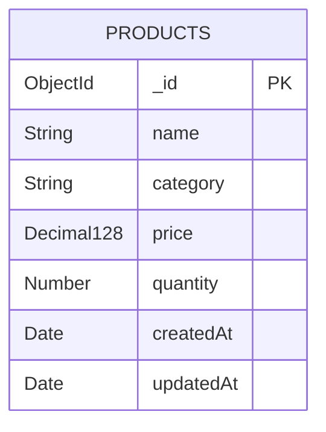

# Week 9: Product fields and initial database model

Owner: Abdullah - Database and Quality Lead.

## Delivered

`backend/models/Product.js` exports a CommonJS Mongoose Product model for the MongoDB `products` collection. It can be imported and validated without a database connection. It does not connect the server or replace the sample API route.

| Field | Stored type | Required | Rules |
| --- | --- | --- | --- |
| `_id` | ObjectId | Automatic | Unique product identifier generated by Mongoose |
| `name` | String | Yes | Trimmed; nonempty; maximum 100 characters |
| `category` | String | Yes | Trimmed; one of the six existing frontend categories |
| `price` | Decimal128 | Yes | Non-negative; at most two decimal places; currency KZT |
| `quantity` | Number | Yes | Integer; 0 through 2,147,483,647 |
| `createdAt` | Date | Automatic on save | Creation timestamp |
| `updatedAt` | Date | Automatic on save/update | Last update timestamp |

Categories: General, Food and Drink, Clothing, Electronics, Supplies, Other.
Category values follow the actual `Frontend` file, refining the unrestricted category text proposed in Week 8. The category list remains a team-editable design decision.
Names are not unique; products are identified by `_id`. No separate category collection or relationships are needed for this initial scope. Unknown schema fields cause an error. Required fields have no defaults, so missing input is not silently accepted.



## Example (validation only)

Run from `backend` after `npm ci`:

```js
const Product = require("./models/Product");

async function example() {
  const product = new Product({
    name: "Notebook",
    category: "Supplies",
    price: "1500.50",
    quantity: 20
  });
  await product.validate();
  console.log(product.toJSON());
}
example().catch(console.error);
```

Price is stored as Decimal128 to avoid binary floating-point storage rounding. JSON returns `price` as a decimal string and maps `_id` to `id`, e.g. `{ "id": "...", "name": "Notebook", "category": "Supplies", "price": "1500.50", "quantity": 20 }`. Timestamp properties appear after persistence. Calling `validate()` alone does not create a database record or set save timestamps.

The current frontend permits whole-number prices and stores them as JavaScript numbers. Those numbers are accepted by this model. Before API integration, Khalid should account for decimal-string prices in responses, and add decimal input support if needed. Converting a price to a JS number is suitable for display, but exact monetary arithmetic needs a separate decision. This model does not calculate inventory totals.

## Later backend integration (Muhammad + Abdullah)

1. Connect Mongoose to MongoDB using an environment variable, not a committed password.
2. Import Product in the API routes.
3. Validate raw HTTP types and allowlist only name, category, price and quantity. Mongoose casts some values (e.g. numeric strings); model validation does not replace request validation. Reject client IDs and timestamps in the API.
4. Use `new Product(allowedFields)`, then `save()` for create. For initial edits, load the document, assign allowed fields, and call `save()` so all document validation runs. Query update methods require explicit validator settings and separate review, especially for stock increment operations.
5. Translate validation/cast/strict errors to 400, missing products to 404, and database errors to a controlled server error.
6. Add actual persistence and CRUD integration tests after connection. Direct MongoDB writes bypass Mongoose validation; collection-level validation can be added at integration.

Authentication, stock movement models, persistence wiring, API CRUD handlers and changes to frontend are later work and are not claimed by this Week 9 deliverable.

## Verification

From `backend`:

```sh
npm ci
npm test
```

Requires Node.js 20.19 or later for the included Mongoose 9 dependency. Verified on Node.js 24.22.1 with Mongoose 9.11.4: **10 tests passed, 0 failed**. Tests validate schema behavior without connecting to MongoDB. They cover required fields, category choices, whitespace and name length, valid/invalid prices, stock bounds, edits, JSON output and schema options. No live database, route, timestamp persistence or end-to-end tests were run.
